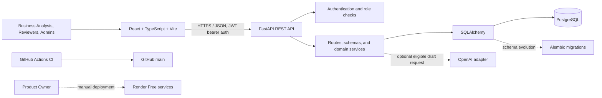

# AI BAP — AI-Powered Business Analysis Platform

### From Requirements to Intelligent Delivery

I built AI BAP to connect business requirements with reviewable User Stories,
acceptance criteria, delivery tasks, and sprint planning. Optional AI-assisted
drafting can help prepare a story, while human review and approval remain part
of the workflow. Project dashboards and traceability views make the path from a
business need to delivery work easier to inspect.

[](https://github.com/imend35/ai-bap/actions/workflows/ci.yml)

## Navigation

[Live demo](#live-demo) · [Reviewer access](#reviewer-access-and-demo-accounts) ·
[Evaluation walkthrough](#five-minute-evaluation-walkthrough) ·
[Features](#implemented-functionality) ·
[Architecture](#architecture-and-technology) ·
[Rubric evidence](#official-capstone-rubric-evidence) ·
[Testing](#testing-and-quality-assurance) ·
[Local setup](#local-setup-and-docker) ·
[Deployment](#deployment-and-operations) ·
[Security and limitations](#security-and-known-limitations) ·
[Documentation](#documentation-and-further-reading) ·
[Submission](#submission-and-peer-review)

## Live Demo

- **Live application:** [ai-bap-frontend-free.onrender.com](https://ai-bap-frontend-free.onrender.com)
- **Verified API health:** [ai-bap-api-free.onrender.com/api/v1/health](https://ai-bap-api-free.onrender.com/api/v1/health)
- **User Guide:** [docs/USER_GUIDE.md](docs/USER_GUIDE.md)
- **Final Submission Report:** [docs/FINAL_SUBMISSION_REPORT.md](docs/FINAL_SUBMISSION_REPORT.md)
- **GitHub Actions:** [workflow runs](https://github.com/imend35/ai-bap/actions)
- **Repository:** [github.com/imend35/ai-bap](https://github.com/imend35/ai-bap)

The Product Owner confirmed that the backend and frontend are deployed at
`75833f9`, using Docker, with `/api/v1/health` as the Render health-check path.
The live API health request returned `{"status":"healthy"}`. This is
Product-Owner-confirmed deployment evidence; no deployment was performed for
this documentation update.

The demo runs on Render Free. A sleeping web service may take time to wake on
the first request after inactivity. Allow for a cold start before retrying a
login or page load. Free-plan service, database lifecycle, and recovery limits
are described in [the deployment guide](docs/deployment-render-free.md) and
[Render's current Free-instance documentation](https://render.com/docs/free).

**Deployment is manual.** A push to GitHub or a successful CI run does not
deploy the Render services.

## Reviewer Access and Demo Accounts

The following identities are referenced by the implementation, but their
existence and successful login in the live Render environment are **NOT
VERIFIED**. Do not assume that either account is active or usable.

| Intended role | Login identifier | Live account status |
|---|---|---|
| Business Analyst | `banlyst@example.com` | NOT VERIFIED |
| Reviewer | `reviwer@example.com` | NOT VERIFIED |

No passwords or access tokens are published here. If accounts are provisioned
and security-checked, the Product Owner must supply credentials privately.
Public registration is disabled in the Render Free configuration; visitors
must not assume anonymous access or attempt to register.

The application has a **shared workspace**, not per-reviewer project or tenant
isolation. Accounts may see and, according to role, change the same records.
Use synthetic data only. Avoid modifying or archiving another participant's
work; the walkthrough below is intended to be read-only.

## Five-Minute Evaluation Walkthrough

Use only credentials explicitly provided by the Product Owner. Do not edit or
delete existing records during evaluation.

| Step | What to inspect | Evidence boundary |
|---|---|---|
| 1. Open the application and sign in | Visit the live frontend, allow for a possible cold start, then sign in with authorized credentials. | The owner reports Admin login passed at `75833f9`; reviewer-account login is not verified. |
| 2. Review the Dashboard | Inspect the project list and available project summary. | Dashboard was reported to load for the Admin smoke test. Other role-specific live views were not reported. |
| 3. Open the sample project | Find **Digital Loan Origination Platform**. | The Product Owner reports this project was created during the smoke journey. |
| 4. Inspect requirements | Review REQ-002, REQ-003, and REQ-004 and their descriptions. | Creation was reported. No additional requirement editing or validation outcome is claimed. |
| 5. Inspect User Stories | Review US-002 and US-003 and their parent requirement relationships. | Creation/linkage was reported. A third REQ-004 story was reported saved, but its ID is unavailable and AC-08/AC-09 were omitted. |
| 6. Review acceptance criteria and traceability | Follow the requirement-to-story links and inspect available criteria. | Persistence and traceability checks were reported as passed for REQ-002 and US-002 only. |
| 7. Inspect Delivery | Review tasks and sprints if present and available to the account's role. | This workflow was not included in the supplied live smoke results. Do not create or reassign items as part of this read-only walkthrough. |
| 8. Review story decisions | Depending on role, inspect review status and approval/rejection actions or audit history. | Role behavior is implemented and described in the User Guide; live reviewer approval was not reported as tested. |
| 9. Consult the full guide | Open [docs/USER_GUIDE.md](docs/USER_GUIDE.md) for screen-level instructions and role details. | The guide distinguishes UI behavior from backend-only API permissions. |

The smoke-test outcomes above were supplied by the Product Owner; they were not
repeated during this README update. See the [final evidence report](docs/FINAL_SUBMISSION_REPORT.md)
for the full record and limitations.

## Business Problem and Solution

Business analysis work can be fragmented across documents and delivery tools.
That fragmentation can make it harder to keep requirements consistent, define
acceptance criteria, review proposed stories, preserve approval history, and
understand how delivery work maps back to business needs. Preparing stories
manually also takes effort, while unreviewed generated content is not suitable
for direct approval.

AI BAP provides one structured workspace for projects, requirements, User
Stories, acceptance criteria, review decisions, tasks, and sprints. It connects
those records through requirement-to-story-to-task traceability and project
dashboards. An optional AI adapter can draft a User Story from a requirement;
the result remains an unsaved draft until a person reviews it and explicitly
confirms the review before saving. AI BAP does not claim quantified productivity
gains.

See the [Product Specification](product-spec.md) and
[Project Charter](docs/project-charter.md) for scope and acceptance criteria.

## Implemented Functionality

### Authentication and authorization

- JWT-based sign-in, profile retrieval, and backend-enforced roles:
  `admin`, `business_analyst`, and `reviewer`.
- Administrator user management is available through protected API routes;
  the current React UI does not provide a user-administration screen.
- Public self-registration is disabled in the Render Free configuration.

### Business analysis and project management

- Create, list, view, and update projects; Admins can archive and restore.
- Create and view requirements in the React interface. The backend supports
  requirement updates for Admin and Business Analyst roles, but the current UI
  has no requirement-edit control.
- Manually create User Stories and acceptance criteria, save drafts, and submit
  stories for review.
- Reviewers and Admins can approve or reject reviewable stories; recorded
  decisions have audit history.
- The UI supports sprint creation/listing and task creation, status changes,
  and sprint assignment. It does not expose general saved-story editing, sprint
  editing, or task title/description editing. Some update operations exist at
  the authenticated API layer; see the User Guide and OpenAPI contract.

### AI-assisted drafting

- Authorized, non-demo Business Analysts and Admins can request an optional
  OpenAI-backed draft when a provider key is configured and the provider is
  available.
- Draft generation does not save or approve the story. Human review is
  required before saving.
- The source at `75833f9` contains backend denial and a disabled frontend
  Generate control for `banlyst@example.com` and `reviwer@example.com`. Focused
  local tests passed in ADIM 8.10.592 (six backend cases and twelve frontend
  App tests); the supplied live smoke test did not test these identities or
  generation. **Production enforcement is NOT VERIFIED.**
- Saved-story provenance is not reliably established by the current data
  model; this README does not label any particular saved story AI-generated.
  BYOK is not supported.

## Realistic Banking Demonstration

The Product Owner reports the following synthetic business-analysis records
were used in the live smoke journey for the **Digital Loan Origination
Platform**:

| Record | Name or relationship | Evidence status |
|---|---|---|
| Project | Digital Loan Origination Platform | Reported created |
| REQ-002 | Enable Digital Personal Loan Applications | Reported created |
| REQ-003 | Enable Automated Personal Loan Eligibility Assessment | Reported created |
| REQ-004 | Enable Controlled Loan Approval and Authorization Workflow | Reported created |
| US-002 | Submit a Digital Personal Loan Application | Reported created and linked to its requirement |
| US-003 | Assess Personal Loan Eligibility Automatically | Reported created and linked to its requirement |
| Third User Story | Saved under REQ-004; generated ID not supplied | Reported saved; AC-08 and AC-09 omitted; identity/completeness not verified |

The demonstrated business flow is:

`Loan Application → Eligibility Assessment → Approval Workflow`

This is a synthetic business-analysis example only. It is not connected to a
real bank, loan-origination platform, credit bureau, or financial service.

## Architecture and Technology



| Area | Technology or boundary |
|---|---|
| Frontend | React, TypeScript, Vite |
| Backend | Python, FastAPI, Pydantic |
| Persistence | PostgreSQL, SQLAlchemy, Alembic |
| Authentication | JWT; Argon2id password hashing |
| API contract | OpenAPI 3.1 in [openapi.yaml](openapi.yaml) |
| Local containerization | Docker Compose for frontend, API, database, and guarded migration initialization |
| Continuous integration | GitHub Actions tests, build, and lint on pull requests and pushes to `main` |
| Hosted demo | Render Free managed PostgreSQL, Docker FastAPI service, and static frontend; deployment is manual |
| Optional AI | OpenAI SDK adapter; requires backend-side provider configuration and is not enabled for the designated demo identities in the inspected source |

## Official Capstone Rubric Evidence

This is a conservative self-assessment, not an official course grade. Evidence
and limitations are detailed in the [Final Submission Report](docs/FINAL_SUBMISSION_REPORT.md).
The rubric requires 10/24 points to pass, but the separate peer-review
requirement below must also be completed.

| Criterion | Maximum Points | Conservative Estimate | Evidence | Limitations |
|---|---:|---:|---|---|
| Problem Description | 2 | **2** | [Problem and solution](#business-problem-and-solution) | No measured productivity claim is made. |
| Product Specification | 2 | **1** | [Product spec](product-spec.md), [GitHub Issue #2](https://github.com/imend35/ai-bap/issues/2) | Public issue has acceptance criteria, but historical agent use of the tracker is not evidenced. |
| Agent Team Specification | 2 | **2** | [Agent team](docs/agent-team.md), [agent workflow](docs/agent-workflow.md) | Defined human-directed roles are not claimed to be autonomous independent agents. |
| Context Management | 2 | **2** | [AGENTS.md](AGENTS.md) and its [modular project context](AGENTS.md#modular-context-documents) | Documentation is the evidence; it does not prove every contributor followed it. |
| Application | 2 | **2** | [Backend](backend/app/), [frontend](frontend/src/), [Compose](compose.yaml), [runtime evidence](docs/codex-reports/adm_8.10.82.md), [browser workflow evidence](docs/codex-reports/adm_8.10.168.md) | Live smoke coverage is selective; one reported REQ-004 story is incomplete and unidentified. |
| Testing | 2 | **2** | [Testing strategy](docs/testing-strategy.md), [test runner](scripts/test-all.ps1), [CI workflow](.github/workflows/ci.yml), [target CI run](https://github.com/imend35/ai-bap/actions/runs/40175160244) | Local 589-backend-test result is not the CI count or a fresh run; broader frontend workflow coverage remains incomplete. |
| Containerization | 2 | **2** | [Compose configuration](compose.yaml), [isolated runtime report](docs/codex-reports/adm_8.10.82.md) | Runtime report is local disposable-environment evidence, not production evidence. |
| Deployment | 2 | **2** | [Live application](https://ai-bap-frontend-free.onrender.com), [API health](https://ai-bap-api-free.onrender.com/api/v1/health), [Render deployment guide](docs/deployment-render-free.md) | Free hosting has lifecycle limits; deployment is manually controlled. |
| CI/CD | 3 | **1** | [CI workflow](.github/workflows/ci.yml), [GitHub Actions](https://github.com/imend35/ai-bap/actions) | CI runs; automatic deployment and verified development CD are not implemented. |
| Observability | 2 | **1** | [Final evidence audit](docs/FINAL_SUBMISSION_REPORT.md) | Published revision has logs but lacks verified correlated metrics/traces collected and viewable in a UI. Local draft/configuration is not runtime evidence. |
| Alerting on User Impact | 1 | **0** | [Final evidence audit](docs/FINAL_SUBMISSION_REPORT.md) | No verified user-impact alert or trigger. |
| On-Call Agent | 2 | **0** | [Agent workflow](docs/agent-workflow.md), [final evidence audit](docs/FINAL_SUBMISSION_REPORT.md) | Incident-response guidance exists; no alert-triggered agent that fixes an issue is implemented and demonstrated. |
| **Total** | **24** | **17/24** | Conservative evidence estimate | Not an official grade; three peer reviews remain mandatory. |

## Testing and Quality Assurance

AI BAP has backend unit and integration tests, mocked frontend tests, an
isolated browser E2E project-creation journey, Ruff, frontend lint, and a
production build. Database-backed test workflows use isolated targets and
fail-closed guards; do not point tests at development or production databases.

- A local backend run recorded **589 tests passed**. This is a local result,
  not a current GitHub Actions count.
- GitHub Actions run [40175160244](https://github.com/imend35/ai-bap/actions/runs/40175160244)
  is associated with commit `75833f9`; its Backend quality and Frontend quality
  jobs completed successfully. That run is the revision-specific CI evidence.
- The previous isolated Playwright report verifies one authenticated local
  project creation/persistence journey; it does not cover every workflow or
  production behavior.
- Broader UI workflow coverage remains a limitation. Review the
  [Testing Strategy](docs/testing-strategy.md) and test files for exact scope.

## Local Setup and Docker

### Prerequisites

- Python 3.13 or later and [uv](https://docs.astral.sh/uv/)
- Node.js and npm
- Docker Desktop with Docker Compose for the complete stack

### Configure a local environment

From the repository root, create a local environment file from the safe
template, then set local-only PostgreSQL values and a securely generated JWT
signing key. Never commit `.env`, real credentials, or provider keys.

```powershell
Copy-Item .env.example .env
```

The optional OpenAI adapter uses a backend environment secret such as
`OPENAI_API_KEY`; do not put it in frontend variables or tracked files. The
frontend accepts `VITE_API_BASE_URL` for its API origin and otherwise uses the
local development default.

### Start the full local stack

```powershell
docker compose up --build -d
```

This starts the PostgreSQL `db`, one-shot `migrate` initializer, FastAPI `api`,
and nginx-hosted `frontend`. Open `http://localhost:8080`; local API health is
`http://127.0.0.1:8000/api/v1/health`. Browser `/api/...` requests are proxied
to the backend. Published ports bind to loopback by default.

The initializer is restricted to a fresh empty application schema and exits
without applying migrations if it detects existing public tables. For safety,
verify database targets before manual Alembic commands. The
[isolated database guide](docs/isolated-test-database.md) is mandatory for
database-backed tests.

To inspect and stop the local stack:

```powershell
docker compose ps
docker compose down
```

`docker compose down` retains the named database volume. Do not add `--volumes`
unless intentionally discarding a disposable local database. See
[Docker configuration](compose.yaml) and the
[isolated Compose runtime report](docs/codex-reports/adm_8.10.82.md).

For non-sensitive diagnostics, inspect `docker compose ps` and use
`docker compose logs migrate`, `docker compose logs api`, or
`docker compose logs frontend`. If `migrate` detects existing public tables,
it intentionally exits without changing that database. If a loopback port is
occupied, set an unused `POSTGRES_PORT`, `API_PORT`, or `FRONTEND_PORT` in the
local `.env`, then restart the intended local project. Never copy credentials
or database connection strings into issue comments or reports.

### Run components directly

For focused backend development, with the verified local database migrated:

```powershell
Set-Location backend
uv sync --extra dev
uv run uvicorn app.main:app --reload --host 127.0.0.1 --port 8000
```

For the frontend, in a second terminal:

```powershell
Set-Location frontend
npm ci
npm run dev
```

Vite normally serves on `http://localhost:5173`. Its API origin can be
configured with `VITE_API_BASE_URL`; the backend's CORS allowlist must include
the exact local origin.

When the API is running, FastAPI serves interactive documentation at
`http://127.0.0.1:8000/docs` and its runtime OpenAPI schema at
`http://127.0.0.1:8000/openapi.json`. The checked-in contract is
[openapi.yaml](openapi.yaml).

### Migrations and tests

Manual Alembic commands must target an inspected, authorized development
database. Never run them against a shared or production database by accident:

```powershell
Set-Location backend
uv run alembic current
uv run alembic upgrade head
```

The database-backed test suite requires the explicitly isolated PostgreSQL
environment in [docs/isolated-test-database.md](docs/isolated-test-database.md).
The repository-root runner is:

```powershell
.\scripts\test-all.ps1
```

It runs frontend tests and then runs backend Pytest only when the exact isolated
test configuration is present. It does not start Docker or run migrations and
fails rather than falling back to a development database. Focused frontend
checks from `frontend` are:

```powershell
npm run test -- --run
npm run build
npm run lint
```

Backend lint from `backend`:

```powershell
uv run --no-sync ruff check app tests migrations/versions
```

## Deployment and Operations

The Render Free deployment uses the repository's
[`render.free.yaml`](render.free.yaml): managed PostgreSQL, a Docker-based
FastAPI web service, and a static React frontend. The API health route and
configured Render health check are `/api/v1/health`.

Automatic deploy triggers are off. The Product Owner reviews the intended
commit and manually deploys the backend and frontend through the Render
Dashboard; a Git push or CI success alone does not release the application.
The Free backend startup wrapper runs the guarded production Alembic migration
before launching the API and prevents startup if that step fails. No production
migration or database operation is authorized by these instructions.

Render Free may cold-start after inactivity. The Free PostgreSQL plan has
provider-defined storage and lifecycle limits and no managed backup guarantee;
demonstration records must be synthetic and treated as disposable. Check
current provider terms and the [deployment runbook](docs/deployment-render-free.md)
before any operational action.

The Product Owner reports that the published services were smoke-tested at
`75833f9`. The tests listed in the
[Final Submission Report](docs/FINAL_SUBMISSION_REPORT.md) are supplied
evidence, not an assertion that this README task re-ran them. No automatic
continuous deployment is claimed.

## Security and Known Limitations

- Passwords are hashed with Argon2id; API access uses JWTs and backend route
  authorization. UI controls are not the security boundary.
- Demo identities are not confirmed active. Credentials must be delivered
  privately by the Product Owner after account and security verification.
- The workspace is shared and has no tenant isolation. Do not expose shared
  credentials publicly or use real, personal, confidential, or production data.
- Live AI generation for the designated demo identities is implemented in
  source but has not been verified against the live service. Non-demo
  generation requires the appropriate role and a configured external provider.
- Render Free cold starts, database lifecycle, and recovery limits apply.
- The published `75833f9` evidence does not establish fully correlated
  end-to-end metrics, traces, and structured logs viewable in a UI. A local
  observability draft is not runtime-verified. User-impact alerting and an
  alert-triggered on-call responder are not implemented and demonstrated.
- Saved stories do not have reliable AI provenance. AI-generated material is
  a draft and requires human review; the application does not support BYOK.

## Documentation and Further Reading

- [User Guide](docs/USER_GUIDE.md) — screens, roles, and end-to-end workflows
- [Product Specification](product-spec.md) and
  [Project Charter](docs/project-charter.md)
- [Architecture](docs/architecture.md) and [OpenAPI contract](openapi.yaml)
- [Agent Team](docs/agent-team.md), [agent workflow](docs/agent-workflow.md),
  and [Agent instructions](AGENTS.md)
- [Testing Strategy](docs/testing-strategy.md) and
  [isolated test database](docs/isolated-test-database.md)
- [Render Free deployment guide](docs/deployment-render-free.md)
- [Authoritative course rubric](docs/Project.md)
- [Final Submission Report](docs/FINAL_SUBMISSION_REPORT.md)
- [Public task-tracker plan](docs/github-issues-plan.md) and
  [GitHub Issue #2](https://github.com/imend35/ai-bap/issues/2)
- [Docker Compose](compose.yaml) and [GitHub Actions CI](.github/workflows/ci.yml)

## Submission and Peer Review

The self-assessed rubric estimate is **17/24**, not an official grade. The
course also requires completing **three peer reviews** of other participants'
projects. Their completion is **NOT VERIFIED** here and is a separate
submission requirement; project points do not replace it. See
[`docs/Project.md`](docs/Project.md) for the authoritative rule and the
[Final Submission Report](docs/FINAL_SUBMISSION_REPORT.md) for the evidence
assessment and outstanding limitations.
