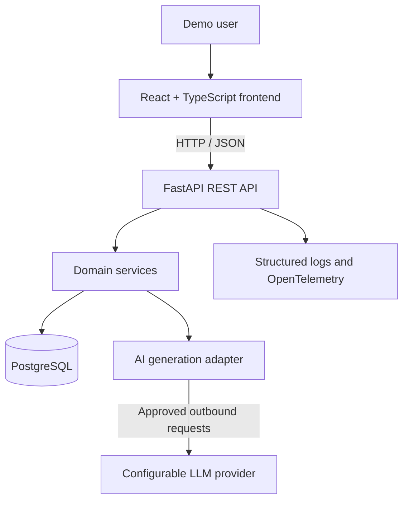

# AI BAP — System Architecture v1.0

**Project:** AI BAP — AI-Powered Business Analysis Platform  
**Version:** 1.0 (Draft)  
**Date:** October 14, 2026  
**Status:** Proposed architecture; implementation pending  
**Architecture style:** Modular monolith with a separate frontend

## 1. Purpose and Architectural Goals

I am designing AI BAP as an AI-assisted business analysis platform that connects requirements, user stories, acceptance criteria, tasks, and sprints. My architecture prioritizes maintainability, traceability, testability, reproducibility, and controlled AI-assisted workflows.

I will implement the initial MVP for a **single demo user**. This is a scope decision, not permission to expose unrestricted write access on the public internet.

## 2. System Context



The frontend will communicate with the backend through a centralized API client. The backend will validate input, enforce business rules, manage persistence, and call the AI provider only through an isolated adapter. API keys will never be sent to the browser.

## 3. Technology Decisions

| Concern        | Selected technology               | Rationale                                         |
| -------------- | --------------------------------- | ------------------------------------------------- |
| Frontend       | React, TypeScript, Vite           | Typed components and fast local development       |
| Backend        | Python, FastAPI                   | Typed request/response models and OpenAPI support |
| Persistence    | PostgreSQL                        | Relational integrity and durable storage          |
| Data access    | SQLAlchemy 2.x                    | Explicit persistence models and transactions      |
| Migrations     | Alembic                           | Versioned schema evolution                        |
| AI integration | Configurable LLM provider adapter | Testability and provider flexibility              |
| API contract   | `openapi.yaml`                    | Contract-first frontend/backend alignment         |
| Backend tests  | Pytest, HTTPX                     | Unit and API integration coverage                 |
| Frontend tests | Vitest, React Testing Library     | Component and business-flow verification          |
| Containers     | Docker, Docker Compose            | Repeatable local environment                      |
| CI/CD          | GitHub Actions                    | Automated quality gates and controlled deployment |
| Observability  | Structured logging, OpenTelemetry | Troubleshooting and operational evidence          |
| AI development | Codex CLI with `AGENTS.md`        | Documented, reviewable AI-assisted development    |

## 4. Logical Modules

I will organize the backend into domain-oriented modules:

- **Projects:** Create, list, update, and archive projects.
- **Requirements:** Capture, edit, classify, and track requirements.
- **User Stories:** Manage stories and acceptance criteria, including links to requirements.
- **Tasks:** Track delivery tasks and their workflow states.
- **Sprints:** Organize sprint dates and task assignments.
- **Traceability:** Read relationships between requirements, stories, and tasks.
- **AI Generation:** Produce draft stories and acceptance criteria; record approval/rejection decisions.
- **Dashboard:** Return summary counts and status aggregates.
- **Health & Operations:** Health endpoints, structured logs, metrics, and traces.

I will keep HTTP routes thin and put business rules in services. Database operations will be isolated in repositories or equivalent persistence abstractions.

## 5. Proposed Repository Layout

```text
ai-bap/
├── README.md
├── AGENTS.md
├── product-spec.md
├── openapi.yaml
├── docker-compose.yml
├── .env.example
├── frontend/
│   └── src/
│       ├── api/
│       ├── components/
│       ├── features/
│       └── pages/
├── backend/
│   ├── app/
│   │   ├── api/
│   │   ├── core/
│   │   ├── db/
│   │   ├── models/
│   │   ├── schemas/
│   │   ├── services/
│   │   └── ai/
│   ├── migrations/
│   └── tests/
├── docs/
│   ├── project-charter.md
│   └── architecture.md
├── agent-capabilities/
├── agent-hooks/
├── mcp-server/
├── security/
├── ops/
└── .github/workflows/
```

This is a **target structure**, not a claim that all directories or features already exist.

## 6. Data Model and Relationships

I will start with the following core entities:

- **Project** (1) → (many) **Requirement**
- **Project** (1) → (many) **Sprint**
- **Requirement** (1) → (many) **UserStory** for the MVP
- **UserStory** (1) → (many) **AcceptanceCriterion**
- **UserStory** (1) → (many) **Task**
- **Sprint** (0 or 1) → (many) **Task**
- **Requirement** (1) → (many) **AIGenerationRecord**

I will use database-level foreign keys and migrations. If future requirements call for many-to-many traceability, I will introduce explicit association tables through a reviewed schema change. The MVP will not depend on a production `User` table while using the single-demo-user approach.

## 7. Core User Journey

1. I create a project and record a business requirement.
2. I request an AI-generated user story and acceptance criteria draft.
3. The backend validates the request and sends only necessary content to the configured AI provider.
4. The backend stores a draft and generation audit record.
5. I review, edit, approve, or reject the draft.
6. An approved story can be linked to tasks and a sprint.
7. I inspect requirement-to-story-to-task traceability and dashboard summaries.

**AI output is never automatically approved or published as a finalized user story.**

## 8. API Design Principles

I will define the API contract in `openapi.yaml` before implementing endpoints. I plan to use versioned routes under `/api/v1`, JSON request/response bodies, explicit Pydantic schemas, consistent HTTP status codes, pagination for collection endpoints, and a consistent error format.

The initial API resource groups will be:

- `/api/v1/projects`
- `/api/v1/requirements`
- `/api/v1/stories`
- `/api/v1/tasks`
- `/api/v1/sprints`
- `/api/v1/ai/generations`
- `/api/v1/dashboard`
- `/healthz`

These are **proposed endpoint groups**; exact methods, payloads, and error schemas will be finalized in the next OpenAPI step.

## 9. Single Demo User and Security Boundary

The local development environment will use a single demo identity and synthetic sample data. I will not present this as production-ready multi-user authentication.

For a public deployment, I will choose and document one of the following before enabling access:

1. A read-only public demo with write operations disabled; or
2. An authenticated, access-controlled demo environment.

I will protect write endpoints server-side; hiding UI buttons is not sufficient. I will configure CORS explicitly, validate all inputs, use environment-based secrets, apply least-privilege database credentials, and avoid exposing database ports publicly.

AI inputs and outputs are untrusted. I will not execute instructions found in user requirements or generated text. I will avoid sending sensitive or secret data to external AI providers.

## 10. Runtime and Deployment

For local development, Docker Compose will orchestrate the frontend, backend, and PostgreSQL services. Database storage will use a persistent volume and health checks will support startup verification.

The cloud hosting provider is **not yet selected**. Before deployment, I will document the selected hosting architecture, configuration, migration process, secret management, deployment rollback approach, and actual public URL.

## 11. Testing Strategy

- **Backend unit tests:** Domain validation and business rules.
- **API integration tests:** Contract-aligned endpoints and database workflows.
- **Frontend tests:** Form validation, state changes, and centralized API client behavior.
- **AI adapter tests:** Mocked provider responses, timeouts, invalid outputs, and approval behavior.
- **End-to-end smoke tests:** Project → Requirement → AI draft → Human approval → Task/Sprint → Traceability.
- **CI gates:** Lint, type checks, tests, and security scans before deployment.

I will use deterministic AI mocks in CI and will not require a paid provider key for routine tests.

## 12. Observability and Operations

I plan to expose a health endpoint and collect structured application logs, request metrics, and traces. Logs will exclude secrets and sensitive prompt content. I will document a reproducible incident diagnosis and collect evidence for the Zoomcamp security and DevOps rubric.

## 13. Agent Extension Architecture

I will maintain `AGENTS.md` and later build a documented extension pack with a requirements specialist workflow, reusable capability, controlled MCP tools, guardrail hook, and permission notes. MCP tools will start with read-only access; any data-changing operation will require explicit authorization and validation.

## 14. Architecture Decisions and Open Questions

| ID      | Decision or question                            | Status                    |
| ------- | ----------------------------------------------- | ------------------------- |
| ADR-001 | Modular monolith backend with separate frontend | Selected                  |
| ADR-002 | Single demo user for MVP                        | Selected                  |
| ADR-003 | PostgreSQL and Alembic migrations               | Selected                  |
| ADR-004 | Human approval for AI-generated stories         | Selected                  |
| ADR-005 | Contract-first OpenAPI design                   | Selected                  |
| ADR-006 | Public demo access model                        | Pending before deployment |
| ADR-007 | LLM provider and model                          | Pending                   |
| ADR-008 | Cloud hosting and deployment topology           | Pending                   |

## 15. Definition of Done for Architecture

I will consider the architecture stage complete when:

- This document is reviewed and committed.
- `openapi.yaml` defines the MVP endpoint contracts and error models.
- The planned data model is consistent with the product specification.
- Security boundaries for local and public demo use are explicit.
- Any architecture changes are documented before implementation.

## 16. Next Step

My next step is to define the **OpenAPI contract v1.0**, beginning with project and requirement management. I will review each endpoint's request/response schema and acceptance criteria before implementing backend code.

