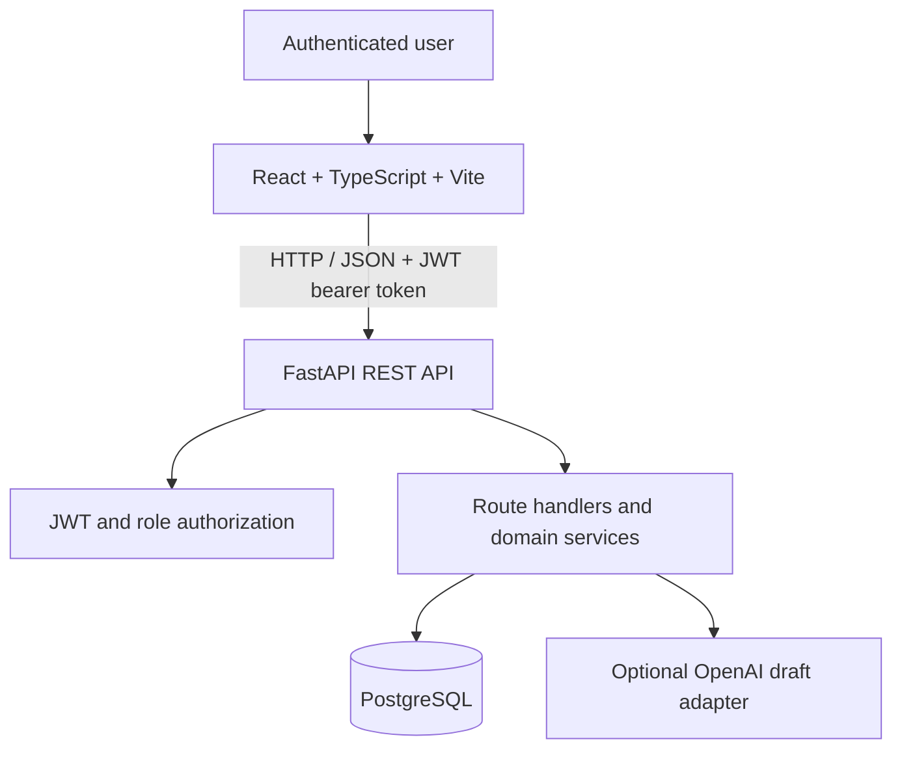

# AI BAP — System Architecture

**Project:** AI BAP — AI-Powered Business Analysis Platform
**Version:** 1.0
**Status:** Implemented MVP architecture with planned enhancements
**Architecture style:** React frontend with a modular FastAPI backend

## 1. Purpose and Architectural Goals

I designed AI BAP to provide an authenticated, traceable business-analysis and
delivery workflow. The current architecture prioritizes clear API boundaries,
relational integrity, server-side authorization, archive-safe historical reads,
and reproducible local verification.

The application is no longer based on a single-demo-user model. It implements
JWT authentication and three backend-enforced roles: `admin`,
`business_analyst`, and `reviewer`.

## 2. System Context



The frontend uses `VITE_API_BASE_URL` when supplied and otherwise targets the
local FastAPI address. The backend validates requests, authenticates JWTs,
authorizes routes, and persists data through SQLAlchemy. The optional AI adapter
is called only when its API key is configured; it is not a claim of a deployed
external AI service.

## 3. Implemented Technology Stack

| Concern | Current implementation |
| --- | --- |
| Frontend | React 19, TypeScript, Vite |
| Backend | Python 3.13+, FastAPI, Pydantic Settings |
| Persistence | PostgreSQL 16, SQLAlchemy 2.x |
| Migrations | Alembic |
| Authentication | JWT using PyJWT; Argon2id password hashing |
| Authorization | Route-level role dependencies |
| API contract | OpenAPI 3.1 in `openapi.yaml` |
| Backend verification | Pytest, HTTPX, Ruff |
| Frontend verification | TypeScript/Vite build and Oxlint |
| Optional AI adapter | OpenAI Python SDK |

Frontend automated tests, CI workflows, public deployment, and OpenTelemetry
instrumentation are not currently evidenced by this repository.

## 4. Application Modules

The FastAPI application registers these API groups under `/api/v1`:

- **Health:** service health response.
- **Authentication:** registration, login, and current-user profile.
- **Administrator users:** administrator-only user creation, listing, update,
  activation, and deactivation.
- **Projects:** paginated archive-aware lists, CRUD, archive/restore, dashboard,
  and traceability.
- **Requirements:** project-scoped requirement CRUD.
- **User stories:** CRUD and optional draft generation.
- **User-story approvals:** approval, rejection, and decision-audit history.
- **Tasks:** story-scoped task CRUD and sprint assignment updates.
- **Sprints:** project-scoped sprint CRUD.

`app.models` contains SQLAlchemy models for users, projects, requirements,
user stories, approval audits, tasks, and sprints. `app.schemas` defines the
validated request and response contracts. Router handlers use shared services
where archive-state locking or AI draft generation is required.

## 5. Data Model and Integrity

The implemented core relationships are:

- Project → Requirements
- Project → Sprints
- Requirement → User Stories
- User Story → Tasks
- User Story → Approval/Reject audit records
- Sprint → assigned Tasks
- User → created records and applicable archive/review actions

PostgreSQL migrations establish schema evolution, constraints, relationships,
readable immutable record numbers, and archive metadata. The current migration
chain includes `c8d9e0f1a2b3`, which corrects record-number formatting for
values wider than three digits.

## 6. Archive and Restore Boundary

Projects have nullable archive timestamp and actor metadata. Administrators can
archive and restore projects without changing their workflow status. Archive
and restore are idempotent.

Authorized users can still read archived project details, dashboards, and
traceability. Mutations to archived project work are rejected by backend
archive-state checks until the project is restored. This preserves historical
visibility without permitting new or changed active work.

## 7. Repository Layout

```text
ai-bap/
├── backend/
│   ├── app/
│   │   ├── models/          # SQLAlchemy models
│   │   ├── routers/         # FastAPI route groups
│   │   ├── schemas/         # Pydantic contracts
│   │   └── services/        # Archive and AI-related services
│   ├── migrations/          # Alembic environment and revisions
│   ├── scripts/             # Guarded helpers and bootstrap command
│   └── tests/               # Backend unit and API tests
├── frontend/
│   └── src/                 # React application
├── docker/                  # Test and migration-rehearsal support
├── docs/                    # Project and operational documentation
├── compose.yaml             # Development PostgreSQL only
├── compose.test.yaml        # Isolated PostgreSQL test database
├── openapi.yaml             # API contract
└── README.md                # Setup and verification instructions
```

## 8. Development and Test Database Topology

The main [compose.yaml](../compose.yaml) creates one loopback-bound PostgreSQL
16 service and persistent development volume. It does not start FastAPI or
Vite. Developers start the backend and frontend as separate local processes.

[compose.test.yaml](../compose.test.yaml) creates a separate Compose project,
database, user, loopback port, and volume for database-backed tests. The
procedure in [isolated-test-database.md](isolated-test-database.md) requires
test-mode confirmations and validates the target before tests import the
application database configuration. A separate legacy-migration test topology
is also documented for approved synthetic-data migration validation.

## 9. API Contract

`openapi.yaml` is the checked-in OpenAPI 3.1 contract. FastAPI exposes runtime
interactive documentation at `/docs` when the backend is running. The contract
documents JWT bearer security, request/response schemas, pagination, project
archive semantics, and supported API groups.

## 10. Runtime and Deployment Position

The current local runtime is intentionally split:

1. PostgreSQL starts through `docker compose up -d`.
2. FastAPI runs locally with Uvicorn.
3. The React frontend runs locally with Vite.

No public deployment, cloud topology, CI pipeline, or full application Compose
runtime is currently claimed. Those are future delivery concerns.

## 11. Testing and Quality Position

Backend tests use Pytest and the isolated PostgreSQL safeguards where database
access is required. Backend linting uses Ruff. The frontend has a passing
TypeScript/Vite production build and Oxlint with no errors; 16 warnings remain
in dependency-driven loading effects. Frontend automated tests are not yet
configured.

## 12. Security Boundaries

- Secrets are supplied through environment variables and are not stored in
  tracked configuration.
- Passwords are hashed, JWTs identify callers, and roles are enforced by the
  backend.
- CORS permits configured local frontend origins rather than unrestricted
  origins.
- The test database is separate from the development database and protected by
  fail-closed configuration checks.
- Optional AI inputs and outputs are treated as untrusted data; an external
  provider key is required before outbound generation is attempted.

## 13. Future Improvements

- Add frontend component and workflow tests.
- Add CI quality gates and deployment documentation.
- Provide a complete frontend/backend container topology.
- Refactor frontend loading state with regression tests to address retained
  Oxlint warnings.
- Expand observability and operational evidence.
